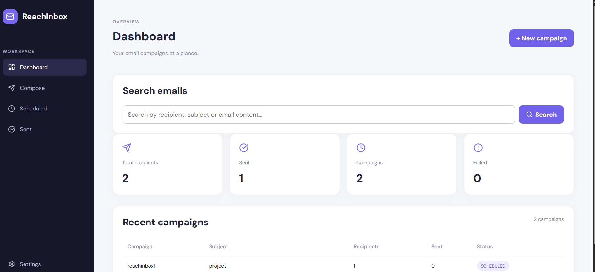
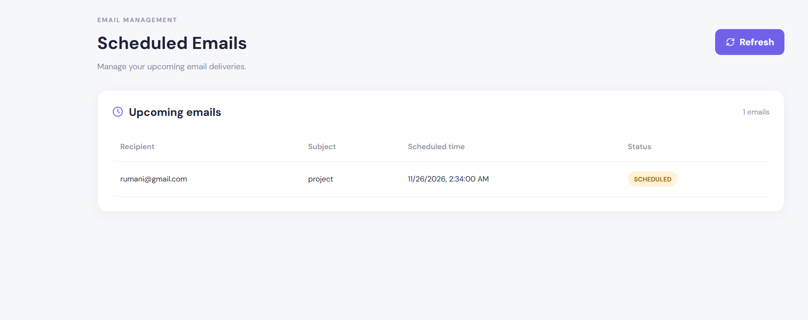
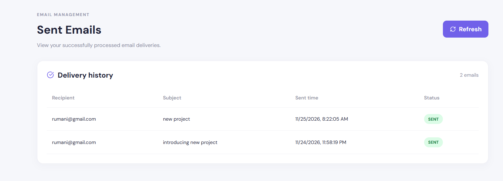
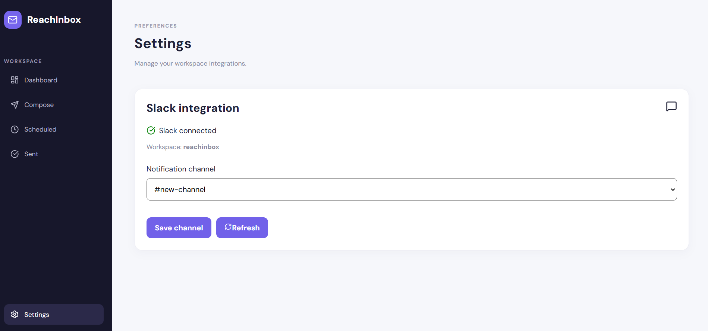

# ReachInbox – Email Job Scheduler

A full-stack email campaign management and scheduling application that simplifies bulk email operations through campaign creation, recipient management, scheduled delivery, email tracking, and Slack notifications.

## Live Demo
🌐 **Website:** https://rumanisadhukhan170204.github.io/ReachInbox/

💻 **GitHub Repository:** https://github.com/RumaniSadhukhan170204/ReachInbox


## Collaborators
The following users have been invited to collaborate on this GitHub repository:

- **mitrajit**
- **Yadav036**

## Screenshots

### Login Page


### Dashboard


### Compose Campaign


### Scheduled Emails


### Sent Emails


### Slack Integration


## Key Features

- Google OAuth 2.0 authentication
- Email campaign creation and management
- CSV/TXT recipient upload and duplicate removal
- Email scheduling
- Configurable email rate limiting
- Dashboard with campaign statistics
- Scheduled and sent email tracking
- Elasticsearch-powered email search
- Redis and BullMQ background job processing
- Automatic retry handling with exponential backoff
- Slack OAuth integration and channel selection
- Campaign status notifications through Slack
- PostgreSQL database with Prisma ORM

## Technology Stack

| Category | Technologies |
|---|---|
| Frontend | React, TypeScript, Vite |
| Backend | Node.js, Express.js, TypeScript |
| Database | PostgreSQL |
| ORM | Prisma |
| Queue Management | Redis, BullMQ |
| Search Engine | Elasticsearch |
| Authentication | Google OAuth 2.0, Passport |
| Email Service | Nodemailer, Ethereal |
| Notifications | Slack API |
| API Communication | Axios |

## System Architecture

1. React frontend communicates with the Express backend.
2. PostgreSQL stores users, campaigns, and email records.
3. Prisma ORM manages database operations.
4. Redis and BullMQ manage asynchronous email jobs.
5. Background workers process scheduled emails.
6. Nodemailer handles email delivery.
7. Elasticsearch provides full-text email searching.
8. Slack API sends campaign notifications.


## Important Configuration

Configure the required environment variables for:

- PostgreSQL
- Redis
- Google OAuth
- Slack OAuth
- Elasticsearch
- SMTP email service
- JWT authentication

## Scheduling, Concurrency, and Rate Limiting

### Worker Concurrency

Worker concurrency is configurable through environment variables.

```env
EMAIL_WORKER_CONCURRENCY=5
```

This controls the number of email jobs processed concurrently by a worker. Multiple workers can also run simultaneously to increase processing capacity.

### Minimum Delay Between Emails

A configurable delay is maintained between individual email sends to prevent sending emails too frequently.

```env
MIN_DELAY_BETWEEN_EMAILS_MS=1000
```

The default delay is 1 second between emails. This value can be adjusted according to the SMTP provider's sending limits.

### Hourly Sending Limit

The maximum number of emails that can be sent per hour is configurable.

```env
DEFAULT_HOURLY_LIMIT=100
```

Redis-backed counters are used to maintain shared rate-limit state across workers and instances.

### Rate-Limit Behavior

When the hourly sending limit is reached:

- Email jobs remain in the BullMQ queue.
- Pending jobs are delayed and rescheduled for the next available hourly window.
- Jobs are not permanently discarded because of rate limiting.
- Email processing order is preserved as far as possible.
- A Slack notification is sent when a sender reaches the hourly limit, provided Slack is connected.

### Handling Large Campaigns

For campaigns containing 1,000 or more recipients:

- Email jobs are added to BullMQ instead of being processed in a single synchronous request.
- Worker concurrency controls parallel job processing.
- The minimum delay controls the frequency of email sends.
- The hourly limit controls the maximum sending volume.
- Jobs exceeding the current hourly allowance are rescheduled for a later sending window.

## Persistence and Idempotency

PostgreSQL stores campaign and email records, while Redis and BullMQ maintain queued and delayed jobs.

The system is designed to support:

- Persistence of future scheduled emails across backend and worker restarts.
- Resumption of pending jobs when workers reconnect.
- Preservation of existing email statuses.
- Prevention of duplicate email processing through stable job identifiers and persistent email-processing state.

SMTP delivery and database updates are separate operations. Therefore, an ambiguous failure between provider acceptance and status persistence requires appropriate idempotency handling and provider-level safeguards.

## Slack Integration

ReachInbox integrates with Slack through OAuth authentication.

The integration flow is:

1. The user clicks **Connect Slack** from the dashboard.
2. The backend initiates the Slack OAuth authorization flow.
3. The user authorizes the application.
4. The backend securely stores the Slack integration credentials.
5. The user selects and saves a Slack channel.
6. The application sends notifications to the configured channel.

Slack notifications are optional. If a user has not connected Slack, email processing continues without notification errors.

When a sender reaches the hourly sending limit, ReachInbox sends a notification to the user's connected Slack channel.
.
# Assumptions and Trade-offs

-Ethereal is used for development email testing, not real delivery.

-PostgreSQL is used for persistent application records.

-Redis and BullMQ are used for asynchronous job processing.

-Elasticsearch is used for email search.

-SMTP provider limits and reliability can affect actual delivery.


Production deployment requires secure environment variables, HTTPS, OAuth callback configuration, and properly configured CORS.
## Future Enhancements

- Production backend deployment
- Advanced email analytics
- Improved campaign monitoring
- Automated testing and monitoring

## Author

**ReachInbox – Email Job Scheduler**

GitHub: https://github.com/RumaniSadhukhan170204
