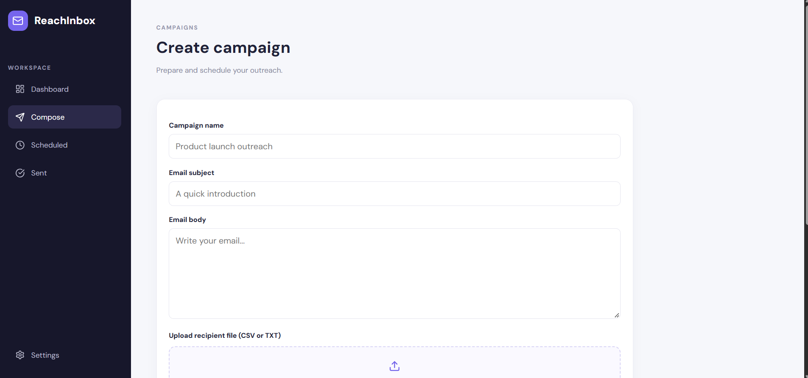

# ReachInbox – Email Job Scheduler

A full-stack email campaign management and scheduling application that simplifies bulk email operations through campaign creation, recipient management, scheduled delivery, email tracking, and Slack notifications.

## Live Demo
🌐 **Website:** https://rumanisadhukhan170204.github.io/ReachInbox/

💻 **GitHub Repository:** https://github.com/RumaniSadhukhan170204/ReachInbox

> Note: The frontend is hosted on GitHub Pages. Backend-dependent features require a separately hosted and configured backend and supporting services.

## Collaborators
The following users have been invited to collaborate on this GitHub repository:

- **mitrajit**
- **Yadav036**

## Screenshots

### Login Page


### Dashboard


### Compose Campaign


### Scheduled Emails


### Sent Emails


### Slack Integration


## Key Features

- Google OAuth 2.0 authentication
- Email campaign creation and management
- CSV/TXT recipient upload and duplicate removal
- Email scheduling
- Configurable email rate limiting
- Dashboard with campaign statistics
- Scheduled and sent email tracking
- Elasticsearch-powered email search
- Redis and BullMQ background job processing
- Automatic retry handling with exponential backoff
- Slack OAuth integration and channel selection
- Campaign status notifications through Slack
- PostgreSQL database with Prisma ORM

## Technology Stack

| Category | Technologies |
|---|---|
| Frontend | React, TypeScript, Vite |
| Backend | Node.js, Express.js, TypeScript |
| Database | PostgreSQL |
| ORM | Prisma |
| Queue Management | Redis, BullMQ |
| Search Engine | Elasticsearch |
| Authentication | Google OAuth 2.0, Passport |
| Email Service | Nodemailer, Ethereal |
| Notifications | Slack API |
| API Communication | Axios |

## System Architecture

1. React frontend communicates with the Express backend.
2. PostgreSQL stores users, campaigns, and email records.
3. Prisma ORM manages database operations.
4. Redis and BullMQ manage asynchronous email jobs.
5. Background workers process scheduled emails.
6. Nodemailer handles email delivery.
7. Elasticsearch provides full-text email searching.
8. Slack API sends campaign notifications.

## Local Installation

### Prerequisites
- Node.js
- PostgreSQL
- Redis
- Elasticsearch
- Git

### Clone Repository

```bash
git clone https://github.com/RumaniSadhukhan170204/ReachInbox.git
cd ReachInbox
```

### Backend Setup

```bash
cd backend
npm install
```

Configure your `backend/.env` file using `.env.example`.

Create a PostgreSQL database named `reachinbox`.

Run:

```bash
npx prisma generate
npx prisma migrate dev
```

Start backend:

```bash
npm run dev
```

### Frontend Setup

Open another terminal:

```bash
cd frontend
npm install
npm run dev
```

### Start Email Worker

Open another terminal:

```bash
cd backend
npm run worker
```

## Important Configuration

Configure the required environment variables for:

- PostgreSQL
- Redis
- Google OAuth
- Slack OAuth
- Elasticsearch
- SMTP email service
- JWT authentication


## Deployment

The frontend is deployed using **GitHub Pages** and GitHub Actions.

GitHub Pages hosts static frontend files only. The backend, database, Redis, Elasticsearch, and email worker require separate hosting for complete online functionality.

## Future Enhancements

- Production backend deployment
- Advanced email analytics
- Improved campaign monitoring
- Automated testing and monitoring

## Author

**ReachInbox – Email Job Scheduler**

GitHub: https://github.com/RumaniSadhukhan170204
